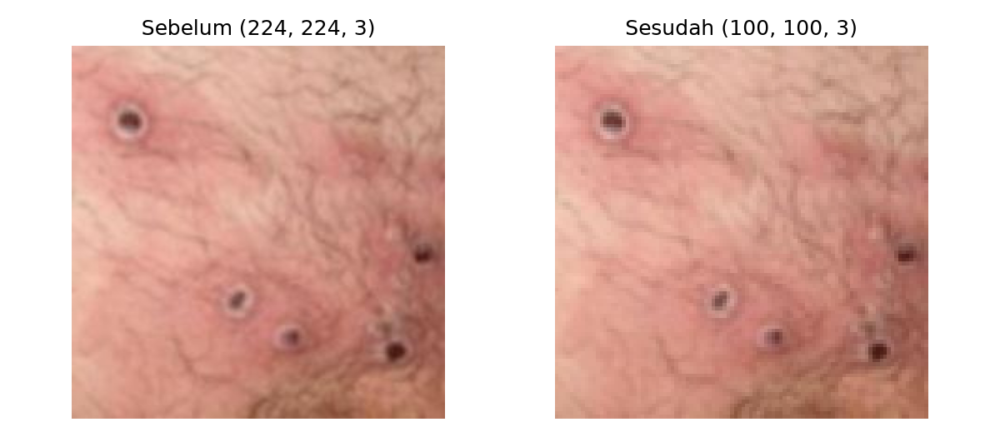
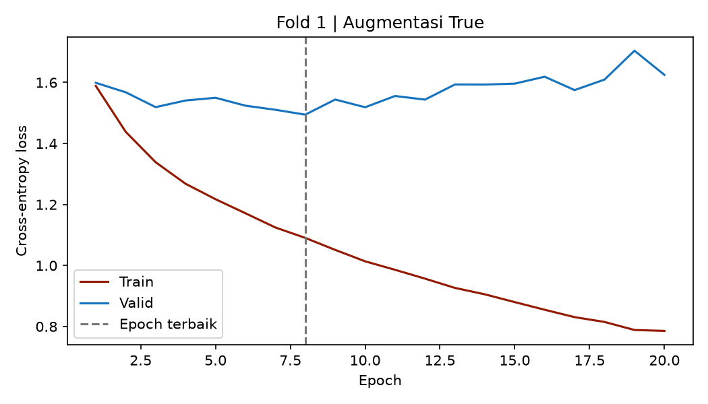
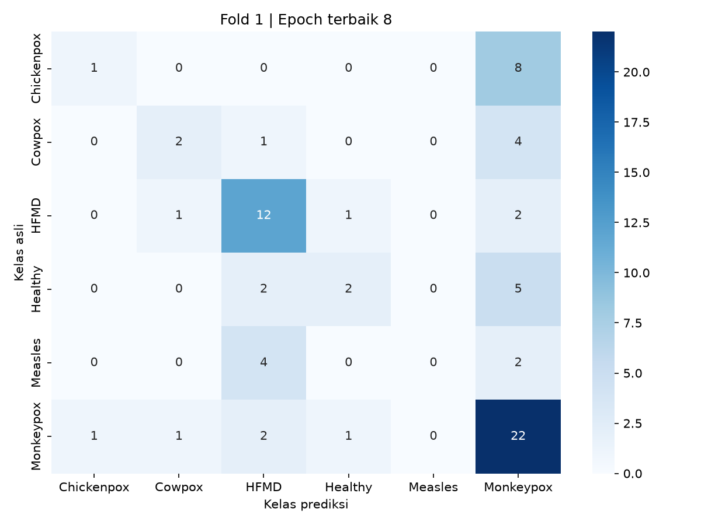

# Tugas 2 IPSD Klasifikasi Foto Kulit Mpox

## Kelompok 1

| Nama | NIM |
|---|---|
| DAFFA ASQALANY | 109102500013 |
| FATIH AL-FAKHRI MUHAMMAD | 109102500004 |
| ILHAM RAMADANNI | 109102500021 |
| DUSTIN MANUEL YOHANES | 109102500029 |

## Video

Tautan YouTube akan ditambahkan setelah rekaman diunggah.

## Dataset dan metode

Percobaan ini membandingkan SimpleCNN dengan dan tanpa augmentasi pada [Mpox Skin Lesion Dataset v2.0](https://www.kaggle.com/datasets/joydippaul/mpox-skin-lesion-dataset-version-20-msld-v20). Dataset memiliki enam kelas. Setiap foto diubah ke ukuran 100 × 100 dan nilai pikselnya dibagi 255.

Kedua percobaan menggunakan lima fold, 20 epoch per fold, batch 32, dan Adam dengan *learning rate* 0,0001. Pada mode augmentasi, Train asli digabung dengan Augmented Train dari fold yang sama. Untuk tiap fold, model dengan *loss* Valid terendah dipilih untuk dievaluasi pada Test asli.

## Hasil rata-rata lima fold

| Metrik | Dengan augmentasi | Tanpa augmentasi |
|---|---:|---:|
| Accuracy | 0,4825 | 0,4116 |
| Precision | 0,4369 | 0,3372 |
| Recall | 0,4825 | 0,4116 |
| F1-score | 0,4344 | 0,3191 |
| ROC-AUC | 0,7634 | 0,7285 |
| Recall khusus Monkeypox | 0,7727 | 0,8904 |

Precision, recall, dan F1 memakai rata-rata berbobot menurut jumlah foto per kelas. ROC-AUC dihitung dengan metode *one-vs-rest* berbobot. Baris rata-rata dihitung dari lima fold dengan bobot yang sama.

| Berkas | Dengan augmentasi | Tanpa augmentasi |
|---|---|---|
| Metrik per fold | [CSV](hasil_dengan_aug/hasil_5fold.csv) | [CSV](hasil_tanpa_aug/hasil_5fold.csv) |
| Log pelatihan | [18 menit 45 detik](hasil_dengan_aug/train_log.txt) | [25 detik](hasil_tanpa_aug/train_log.txt) |
| Kurva loss | [Fold 1](hasil_dengan_aug/training_fold1.png) · [2](hasil_dengan_aug/training_fold2.png) · [3](hasil_dengan_aug/training_fold3.png) · [4](hasil_dengan_aug/training_fold4.png) · [5](hasil_dengan_aug/training_fold5.png) | [Fold 1](hasil_tanpa_aug/training_fold1.png) · [2](hasil_tanpa_aug/training_fold2.png) · [3](hasil_tanpa_aug/training_fold3.png) · [4](hasil_tanpa_aug/training_fold4.png) · [5](hasil_tanpa_aug/training_fold5.png) |
| Confusion matrix | [Fold 1](hasil_dengan_aug/confusion_matrix_fold1.png) · [2](hasil_dengan_aug/confusion_matrix_fold2.png) · [3](hasil_dengan_aug/confusion_matrix_fold3.png) · [4](hasil_dengan_aug/confusion_matrix_fold4.png) · [5](hasil_dengan_aug/confusion_matrix_fold5.png) · [Rata-rata](hasil_dengan_aug/confusion_matrix_rata_rata.png) | [Fold 1](hasil_tanpa_aug/confusion_matrix_fold1.png) · [2](hasil_tanpa_aug/confusion_matrix_fold2.png) · [3](hasil_tanpa_aug/confusion_matrix_fold3.png) · [4](hasil_tanpa_aug/confusion_matrix_fold4.png) · [5](hasil_tanpa_aug/confusion_matrix_fold5.png) · [Rata-rata](hasil_tanpa_aug/confusion_matrix_rata_rata.png) |

## Contoh Gambar dan Grafik







Pada confusion matrix, baris menunjukkan kelas asli, kolom menunjukkan prediksi, dan diagonal menunjukkan prediksi yang benar. Jumlah gabungan lima fold tersedia untuk mode [dengan augmentasi](hasil_dengan_aug/confusion_matrix_total.csv) dan [tanpa augmentasi](hasil_tanpa_aug/confusion_matrix_total.csv). Beberapa foto muncul pada Test lebih dari satu fold. Karena itu, matriks gabungan menghitung 364 entri evaluasi dari 297 kombinasi kelas dan nama file yang unik.

## Interpretasi Hasil

1. **Apakah augmentasi membantu?** Akurasi naik 7,09 poin persentase dan F1 berbobot naik 11,53 poin. Recall khusus Monkeypox turun 11,77 poin. Penambahan gambar juga membuat jumlah langkah optimizer per epoch lebih banyak.
2. **Kelas mana yang sering salah?** Dengan augmentasi, 40 dari 42 entri Chickenpox salah dan 35 di antaranya diprediksi sebagai Monkeypox. Tanpa augmentasi, HFMD punya jumlah kesalahan terbesar, yaitu 51 dari 82 entri. Measles punya persentase kesalahan tertinggi, dengan 30 dari 30 entri salah dan 15 diprediksi sebagai HFMD. Kemiripan pola pada foto dan detail yang berkurang saat resize bisa menjadi dugaan awal.
3. **Berapa recall Monkeypox?** Rata-rata lima fold adalah 77,27% dengan augmentasi dan 89,04% tanpa augmentasi. Pada matriks gabungan, masing-masing mode melewatkan 28 dan 14 dari 125 entri Monkeypox. Recall langsung memperlihatkan berapa bagian dari kelas tersebut yang berhasil dikenali, sehingga berguna saat menilai jumlah entri yang terlewat.
4. **Bagaimana memperbaiki model?** Pada Fold 1 dengan augmentasi, *loss* Valid terendah ada di epoch 8. Sampai epoch 20, *loss* Train turun dan *loss* Valid berakhir lebih tinggi. Pola ini mengarah ke *overfitting*. Salah satu percobaan berikutnya adalah menambahkan dropout sebelum lapisan linear dan membandingkan *loss* Valid.

## Menjalankan Proyek

Buka folder proyek di VS Code. Jika belum punya lingkungan Python, buat `.venv` dan pasang dependensi dari PowerShell.

```powershell
python -m venv .venv
.\.venv\Scripts\python.exe -m pip install -r requirements.txt
```

Pilih interpreter `.venv\Scripts\python.exe` lewat **Python: Select Interpreter**. Ekstrak dataset ke `Dataset/` sesuai jalur dalam `config.py`. Gunakan **Run Python File** pada masing-masing skrip.

1. Jalankan `cek_dataset.py` dan `cek_ukuran.py`.
2. Simpan `PAKAI_AUG = True` di `config.py`. Jalankan `train.py`, tunggu baris `Selesai:`, lalu jalankan `test.py`.
3. Ubah `PAKAI_AUG = False` dan simpan. Ulangi `train.py` lalu `test.py`.

Tabel, log, dan grafik yang sudah tersedia dapat langsung dibuka di kedua folder hasil. Saat evaluasi tersimpan tersedia, `test.py` membacanya sesuai mode. Dataset dan checkpoint `.pt` disimpan secara lokal.
